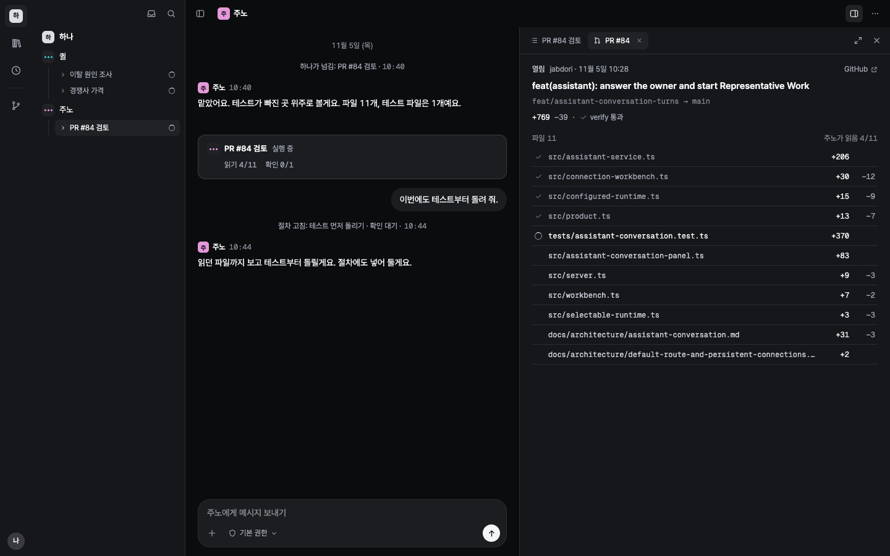
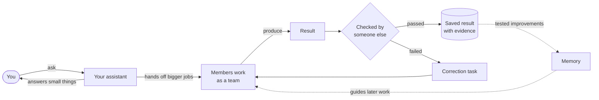

# Massion

**Your own AI team, running on your computer.** You talk to one assistant. Behind it, named members do the work, someone else checks every result, and what passed the check is kept with its evidence.

<picture>
  <source media="(prefers-color-scheme: light)" srcset="docs/product/screens/artboards/light/B22-room.png">
  
</picture>

<sub>Approved screen design for a member reviewing a pull request. The interface is in Korean.</sub>

## What it does

- **One continuing conversation.** Opening Massion continues where you left off. Short questions get a direct answer; bigger jobs are handed to the team.
- **Named members, not anonymous agents.** Each member has a name, a role and its own conversation with you. Members work together in a room and can challenge each other.
- **Nobody approves their own work.** A separate check, by a different model or a fixed rule, decides whether a result is accepted.
- **Results are kept, not just said.** An accepted result is saved with the request, the criteria and the evidence that it passed.
- **It never quietly retries.** If Massion cannot tell whether something happened (a payment, a sent message), it says so and waits for you. It does not send it again.
- **You decide the things that matter.** Spending money, sending in your name, deleting data, adding a member, and changing permissions always come to you.

## How it works

Read this left to right: a request either gets a direct answer or becomes a task that is done, checked and saved.



The [concepts page](docs/product/concepts.md) explains each step and says what is built today and what is still planned.

## Quick start

You need macOS or Linux, Node 24.19 or newer 24.x, Python 3 and [SurrealDB 4.0.1](https://github.com/surrealdb/surrealdb/releases/tag/v4.0.1).

```sh
git clone https://github.com/jabdori/massion.git
cd massion
npm ci --ignore-scripts --no-audit --no-fund
```

Start the database in one terminal:

```sh
mkdir -p .runtime/db-tmp
surreal start "surrealkv://$(pwd -P)/.runtime/database" \
  --bind 127.0.0.1:18080 --unauthenticated \
  --default-namespace massion --default-database massion \
  --temporary-directory "$(pwd -P)/.runtime/db-tmp" \
  --deny-net --deny-scripting
```

Start Massion in a second terminal, then open <http://127.0.0.1:8765>:

```sh
MASSION_SURREAL_RPC=http://127.0.0.1:18080/rpc \
MASSION_SURREAL_NAMESPACE=massion MASSION_SURREAL_DATABASE=massion npm start
```

> [!IMPORTANT]
> This setup has no sign-in and listens only on your own machine. Keep it private. No model is called until you configure and authorize a connection.

The [guide](docs/guide/README.md) walks through the first conversation. The [full reference](docs/guide/source-checkout.md) covers installation checks, data location, upgrades, backup, tests and troubleshooting.

## Status

Massion is at **0.9.0**, a 0.x development version that stays at 0.x until it is verified: an unsigned build for a single owner, run from source.

> [!NOTE]
> The automated tests run against local fixtures, not live models or real accounts. They show that the flow, restart recovery and backup work; they do not show model quality. One separately authorized live run is recorded in the [E9b smoke](docs/acceptance/e9b/README.md). Signing, notarization and publishing are not done. Details: [candidate status](docs/guide/source-checkout.md#candidate-status-and-evidence-boundaries), [changelog](CHANGELOG.md).

## Documentation

| I want to… | Read |
| --- | --- |
| Try it | [Guide](docs/guide/README.md) |
| Understand the ideas | [Concepts](docs/product/concepts.md) |
| See how it is built | [Architecture overview](docs/architecture/README.md) |
| Know how it got here | [The story so far](docs/product/story.md) |
| Know why it is built this way | [Decisions](docs/README.md#decisions) |
| Find anything else | [Documentation map](docs/README.md) |

The earlier implementation is preserved in [massion-archive](https://github.com/jabdori/massion-archive); this repository has its own history.
