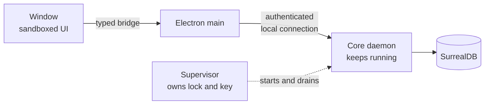

# Massion desktop development app

This unsigned Electron app shows the existing workbench in its own window. It is only a window: all lasting state stays in the core (the daemon) and SurrealDB. See [the design and boundaries](../docs/architecture/desktop-shell.md).



## Run

Use Node 24.19 or later in the Node 24 line. From the repository root:

```sh
npm ci --prefix desktop --ignore-scripts --no-audit --no-fund
npm run install:electron --prefix desktop
npm start --prefix desktop
```

| Setting | Purpose | Default |
| --- | --- | --- |
| `MASSION_SURREAL_RPC` | Developer override: use this database address instead of starting the bundled SurrealDB | none; required only when no bundled runtime is staged |
| `MASSION_SURREAL_NAMESPACE`, `MASSION_SURREAL_DATABASE` | Optional database selection | the server's normal defaults |
| `MASSION_DAEMON_ORIGIN` | Another explicit `http://127.0.0.1:<port>` for the managed daemon | `http://127.0.0.1:8765` |
| `MASSION_NODE_BINARY` | Developer override (unpackaged runs only): a Node 24 executable for the daemon (the core inherits it) | the bundled `Resources/runtime/node` |

With no environment variables, the packaged app starts everything itself. The shell starts the daemon on the bundled `Resources/runtime/node`; the daemon verifies both bundled executables against `Resources/runtime/manifest.json` (SHA-256; a mismatch or missing file starts nothing, cause `runtime-damaged`), starts `Resources/runtime/surreal` with TLS (a self-signed EC P-256 certificate made for this start, valid for ten years) bound to `127.0.0.1` on a free port, waits for readiness for up to 30 seconds (initial default), and then starts the core with that address; every request to the database — the supervisor’s readiness and bootstrap checks and every core query — pins this start’s certificate. In a packaged app the two developer overrides are ignored entirely and both bundled executables are always verified first; they apply only to an unpackaged development run, which without a staged runtime behaves as before and still requires `MASSION_SURREAL_RPC`. No credentials cross the renderer bridge.

### Bundled database data and authentication

Data lives in the app's private user-data directory:

```text
<userData>/database/    SurrealDB data, plus two Massion files:
  password              random 256-bit database password, mode 0600
  version               SurrealDB version and data format that created the data
  initialized           marker with a salted digest of the password, written only after\n                        an authenticated request has succeeded
<userData>/db-tmp/      SurrealDB temporary files\n<userData>/database-tls.crt, database-tls.key\n                        the start's certificate and private key, mode 0600, created\n                        exclusively for one start and deleted once the database's own\n                        start line has been read\n<userData>/database.pid the database keeper's record while it runs
```

First creation of the data generates the password, stores it in `database/password` (written atomically, mode 0600) **before** the database starts, and passes it to SurrealDB exactly once through the `SURREAL_PASS` environment variable of that child only. No credential is sent to the database port until the database child itself has printed the start line naming the address it bound; a stranger taking the port between probe and bind makes the child exit instead, and if the database exits later the supervisor sends the core SIGTERM and then SIGKILL 500 ms after it processes the exit notice (neither the notice's travel time nor the timer is a real-time bound; the 500 ms delay allows one busy event-loop turn for the core's SIGTERM handler to stop new work without waiting for a 10-second drain that cannot succeed without the database). The initialization marker (with a salted SHA-256 of the password) is written unconditionally once an authenticated verification request against the new database has succeeded (even if the database exits right after answering); a launch interrupted before that verification succeeds (while no database store files exist) repeats the bootstrap with the same stored password, never a second one, whereas a crash or kill in the narrow window between the verification response and the marker rename leaves store files without a marker (issue #183); the next start recovers that folder by starting the database with no credential and proving the stored password with one pinned authenticated request before writing the marker. If that proof fails the start is still refused with `data-credential` and the app rewrites nothing in the folder; the owner can put back a matching `password` file (from a backup of this data folder) and start again. On later starts a well-formed but wrong password is detected against the marker before anything is started or written. Later starts give the database no password; the core receives it over an anonymous pipe (like the supervisor key) and the start's certificate over a second anonymous pipe, and authenticates through the transport's existing `authorization` option; a managed https endpoint without a readable certificate pipe refuses to start (cause `core-start`). Startup is declared only after the core answers the supervisor's authenticated challenge — a stranger already holding the core port is reported as `core-start`, not success. The password is never rotated and never recreated: if the file is missing, unreadable, not 0600, or fails the marker digest, nothing starts (cause `data-credential`) and no file is written. The user-data, database and temporary folders must each be a real directory owned by this user with no group or other permission bits (cause `data-credential` otherwise), so another operating-system user cannot plant a password or redirect the folders. A data folder whose recorded SurrealDB version differs from the bundled one refuses to start (cause `data-version`); there is no migration in this slice.

When the daemon cannot start, it reports one typed cause (`runtime-damaged | database-start | data-credential | data-version | core-start`) with a technical detail that never contains the password. Quitting drains the core first, then stops the database (SIGTERM, bounded wait, then SIGKILL; the 54-second figure is the sum of the phase timers plus the up-to-2-second unclosed-keeper probe; file operations are not separately bounded) and reports success only once the keeper's stdout has closed after observing the database exit (or confirming no child was spawned), or—when the keeper did not close—both any reported database child and the keeper process itself are proved gone via `/bin/ps`. The database runs under a small keeper process: the daemon holds the keeper's stdin, and when that pipe ends (however the daemon died) the keeper stops the database and exits, unless the child survives termination or the keeper itself is killed unexpectedly. If a stop cannot be proved cleanly, drain returns `unsettled`; neither keeper nor supervisor unlinks `database.pid` unless the database exit (or spawn failure) was already observed. Before starting, the supervisor reads `database.pid` (refusing if unreadable) and scans the live process list via `/bin/ps -ax -ww -o pid=,stat=,lstart=,args=` for our keeper or any database process holding this data folder (`start surrealkv://<this-folder>`, matched canonically regardless of binary path); if either shows a live previous instance, it refuses with `database-start` (`a previous database for this data folder is still running`), and if `database.pid` is unreadable or `/bin/ps` fails, times out, or cannot be parsed, it refuses with `database-start` and a detail stating the check could not be completed (`try again`). This state clears once that process actually exits (the owner quits it, it exits on its own, or the Mac restarts), at which point the next start proves no matching process is running and removes any stale `database.pid`.

> **Limits, stated once.** Decision D: authentication stops other users on this Mac, processes that can reach the port but not the files, and web pages in the user's browser talking to `127.0.0.1`.
>
> **Certificate pinning, stated once.** Every request to the managed database pins the certificate made for that start. What pinning stops: a process of another operating-system user that takes the port after the database dies, or any process that can reach the port but cannot read the key — it receives a TLS ClientHello and nothing else. What pinning does not stop: a process running as the same user that reads the key file while it exists or the process memory, denial of service by taking the port, and the certificate path being tampered with by the same user.
>
> **A process running as the same user** can do all of these, and this is the accepted limit: replace the password file and the initialization marker together (the digest then matches), swap a checked folder for a symlink between the check and the open, and replace a bundled executable between its hash check and execution. Two cheap narrowings are taken: the data-folder listing is read through one opened directory handle so it cannot be redirected mid-listing, and both folders are re-checked immediately before the database spawns. The hash-to-execution window for the executables is not closed.

> [!IMPORTANT]
> Reattachment requires this user's authenticated supervisor at the same origin. A bare `npm start` host, or a process impersonating protocol v1, is refused; no commands are sent to an unauthenticated port. Stop an older unauthenticated daemon once and let the updated app relaunch it. There is no compatibility fallback that bypasses this check.

## Windows, quitting and the daemon

| You do | What happens |
| --- | --- |
| Close every window | The daemon and the exception observer keep running. Reopen through the app icon, another launch or a notification. |
| Choose **Quit** | The managed daemon is asked to drain. A drain timeout is unsettled, not success: the supervisor keeps its lock until the child exits. |
| Start a second copy | The supervisor's kernel socket lock prevents two starters from serving. A refused stale socket may be reclaimed only by the single-instance launcher; a live PID is never killed to take ownership. |

The daemon's private control socket and PID record live under Electron's `userData` path, with `daemon.log` for startup and drain errors. There is no launch-at-login installation in E4.

## How the window proves it is talking to the right core

1. Every supervisor launch creates a random 256-bit key, held in memory and passed to the core on an anonymous pipe.
2. The shell obtains it only through the owner's 0600 control socket in the 0700 app-data directory.
3. Each HTTP request first verifies a fresh, origin-bound HMAC server proof, then sends a derived client proof and application data on that exact TCP connection.

The key is never stored in the PID record, environment, arguments, logs or renderer. A replacement socket, another port's proof, or a missing key is refused without a command retry. The supervised server also rejects unauthenticated legacy routes and feed reads.

## Verify without opening a window on the owner's machine

```sh
npm run fetch-runtime --prefix desktop
npm run typecheck --prefix desktop
npm test --prefix desktop
docker build -f desktop/tests/Dockerfile -t massion-e4-smoke .
docker run --init --cap-add=SYS_ADMIN --security-opt seccomp=unconfined \
  massion-e4-smoke dbus-run-session -- xvfb-run -a npm run smoke
```

`npm run fetch-runtime` stages the pinned SurrealDB 4.0.1 binary that the
runtime tests require (or point `MASSION_SURREAL_BINARY` at an installed
4.0.1 binary, the CI download path).

The container contains only repository source and fixture data. Its extra
capability enables Chromium's sandbox namespaces inside Docker; Electron's
sandbox stays enabled. Do not add `--no-sandbox`. On a Linux CI host with Xvfb,
run `npm run build --prefix desktop` then
`xvfb-run -a npm run smoke --prefix desktop`. The smoke refuses native macOS and
Windows execution and writes screenshots plus an accessibility tree under
`desktop/smoke-artifacts/`. It makes no real provider calls.
Only the smoke launcher disables GPU acceleration before Electron becomes ready;
the production launcher and renderer security settings remain unchanged.

## Package for macOS

```sh
npm run package:mac --prefix desktop
```

The app is written to `desktop/release/mac-<arch>/Massion.app` (`release/mac` on
Intel). Packaging includes the standalone daemon runner outside ASAR, the core
sources, their app-handler runner and runtime copy table, hashes bundled scripts/styles
for CSP, and applies all seven ADR 0005 security fuse settings before signing
would occur. No distribution identity, notarization or release is used; the owner
follows the [release checklist](../docs/guide/release.md) for those steps. The
default Electron icon is retained for this development slice.
The packaging command finishes by checking the actual `.app` resource paths with
external Node. Unit tests apply the resource filters instead of copying all files.

### Bundled runtime executables

The packaged app carries two official executables at `Contents/Resources/runtime/`:
`node` and `surreal`. The pinned versions, download URLs and archive SHA-256
values live in [`runtime.json`](./runtime.json), keyed by
`platform-architecture` (`darwin-arm64` today). `fetch-runtime.mjs` runs at
package time only: it downloads each archive over HTTPS with redirects restricted
to HTTPS, verifies the archive SHA-256 before extracting, extracts only the one
executable, and refuses on any mismatch. Archives are cached under
`.runtime-cache/` keyed by SHA-256, so a rebuild does not download again. The
placed executables are mode 0755 and `runtime/manifest.json` records each tool's
version and the SHA-256 of the executable as placed; `package.test.ts` re-checks
both files against that manifest. The packaged app starts both executables as
described above.

The version comes from the root `package.json`, injected by
`electron-builder.cjs`; the desktop manifest has no independent version.
The `mac-dev-package` CI job uploads a `Massion-<version>-macOS-<arch>-unsigned.zip`
archive and separate install-smoke evidence. Extract the archive with `ditto -x -k`
to retain its bundle structure. It has no Developer ID signature or notarization.

After packaging, run the macOS fixture journey without displaying a window:

```sh
npm run smoke:install --prefix desktop
```

This launches the actual `.app` executable with `--massion-headless`, a new private
user-data directory and a loopback CDP port. It suppresses window display/focus,
Dock activation and notifications, inspects an unknown Work through the bundled
UI, preserves its state, and drains the disposable authenticated fixture daemon.
It uses the lockfile-pinned local `agent-browser` 0.41.2, verifies app bytes,
executable modes and symlink targets before and after the journey, and writes evidence under
`desktop/smoke-artifacts/install/`. It does not use a real database or provider,
change the installed app's data or prove a new model run. The existing Linux
Xvfb security smoke remains a separate check.

## Current boundary

| Part | What it does today |
| --- | --- |
| **UI loading** | The app loads its own bundled UI at `massion://app/`; main forwards only `/protocol/connect`, `/protocol/request` and `/protocol/events` to the loopback host. The UI keeps its existing client, SSE catch-up, generation fences and write barrier. |
| **Bridge** | The preload exposes only a typed focus subscription and a fixed ready acknowledgement; it exposes no IPC object, arbitrary channel, path or URL. The generated host adapter calls existing Work and decision opening functions. Screen code is unchanged; the core adds the supervisor authentication guard. |
| **Notifications** | They read the existing global conversation Work list and owner-decision views every 10 seconds, including while windows are closed. Normal progress and completion are silent. Identity, feed and exception kind deduplicate alerts; resolved or replaced targets cannot open an old Work. |
| **Version states** | The existing protocol's `update-needed` and `restart-needed` states are passed through without admitting writes. General now displays the installed app version, a device-local notification preference and its restart-required state. |
| **Restart** | Restart drains the authenticated local daemon before relaunching Massion; an unconfirmed drain blocks another attempt. The preference takes effect at the next app start and does not claim OS permission. |

> [!NOTE]
> **Not claimed by this shell.** The existing global list is bounded to 200 conversation Works; paging and non-conversation legacy Work notifications are not claimed. Native delivery depends on OS notification permission; fixture tests verify selection and click-to-focus, not a real macOS notification center. External CLI restart and app update availability remain unknown without their own producer. This is the loopback development transport explicitly requested by E4: the user-only command socket transport, installer discovery and signed distribution remain outside this shell increment.

See [device lifecycle](../docs/architecture/device-lifecycle.md).
