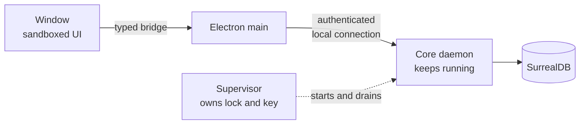

# Massion desktop development app

This unsigned Electron app shows the existing workbench in its own window. It is only a window: all lasting state stays in the core (the daemon) and SurrealDB. See [the design and boundaries](../docs/architecture/desktop-shell.md).



## Run

Use Node 24.19 or later in the Node 24 line. From the repository root:

```sh
npm ci --prefix desktop --ignore-scripts --no-audit --no-fund
npm run install:electron --prefix desktop
npm start --prefix desktop
```

| Setting | Purpose | Default |
| --- | --- | --- |
| `MASSION_SURREAL_RPC` | Database address, so the app can start the existing server | none; required for the app to start the server |
| `MASSION_SURREAL_NAMESPACE`, `MASSION_SURREAL_DATABASE` | Optional database selection | the server's normal defaults |
| `MASSION_DAEMON_ORIGIN` | Another explicit `http://127.0.0.1:<port>` for the managed daemon | `http://127.0.0.1:8765` |
| `MASSION_NODE_BINARY` | An installed Node 24 executable | `node` on the launch environment's PATH |

The app does not bundle Node or SurrealDB. Normal host environment configuration remains available; no credentials cross the renderer bridge. The server uses the app's private user-data directory as its working directory, so new runtime artifacts live there under `.runtime/`.

> [!IMPORTANT]
> Reattachment requires this user's authenticated supervisor at the same origin. A bare `npm start` host, or a process impersonating protocol v1, is refused; no commands are sent to an unauthenticated port. Stop an older unauthenticated daemon once and let the updated app relaunch it. There is no compatibility fallback that bypasses this check.

## Windows, quitting and the daemon

| You do | What happens |
| --- | --- |
| Close every window | The daemon and the exception observer keep running. Reopen through the app icon, another launch or a notification. |
| Choose **Quit** | The managed daemon is asked to drain. A drain timeout is unsettled, not success: the supervisor keeps its lock until the child exits. |
| Start a second copy | The supervisor's kernel socket lock prevents two starters from serving. A refused stale socket may be reclaimed only by the single-instance launcher; a live PID is never killed to take ownership. |

The daemon's private control socket and PID record live under Electron's `userData` path, with `daemon.log` for startup and drain errors. There is no launch-at-login installation in E4.

## How the window proves it is talking to the right core

1. Every supervisor launch creates a random 256-bit key, held in memory and passed to the core on an anonymous pipe.
2. The shell obtains it only through the owner's 0600 control socket in the 0700 app-data directory.
3. Each HTTP request first verifies a fresh, origin-bound HMAC server proof, then sends a derived client proof and application data on that exact TCP connection.

The key is never stored in the PID record, environment, arguments, logs or renderer. A replacement socket, another port's proof, or a missing key is refused without a command retry. The supervised server also rejects unauthenticated legacy routes and feed reads.

## Verify without opening a window on the owner's machine

```sh
npm run typecheck --prefix desktop
npm test --prefix desktop
docker build -f desktop/tests/Dockerfile -t massion-e4-smoke .
docker run --init --cap-add=SYS_ADMIN --security-opt seccomp=unconfined \
  massion-e4-smoke dbus-run-session -- xvfb-run -a npm run smoke
```

The container contains only repository source and fixture data. Its extra
capability enables Chromium's sandbox namespaces inside Docker; Electron's
sandbox stays enabled. Do not add `--no-sandbox`. On a Linux CI host with Xvfb,
run `npm run build --prefix desktop` then
`xvfb-run -a npm run smoke --prefix desktop`. The smoke refuses native macOS and
Windows execution and writes screenshots plus an accessibility tree under
`desktop/smoke-artifacts/`. It makes no real provider calls.
Only the smoke launcher disables GPU acceleration before Electron becomes ready;
the production launcher and renderer security settings remain unchanged.

## Package for macOS

```sh
npm run package:mac --prefix desktop
```

The app is written to `desktop/release/mac-<arch>/Massion.app` (`release/mac` on
Intel). Packaging includes the standalone daemon runner outside ASAR, the core
sources, their app-handler runner and runtime copy table, hashes bundled scripts/styles
for CSP, and applies all seven ADR 0005 security fuse settings before signing
would occur. No distribution identity, notarization or release is used; the owner
follows the [release checklist](../docs/guide/release.md) for those steps. The
default Electron icon is retained for this development slice.
The packaging command finishes by checking the actual `.app` resource paths with
external Node. Unit tests apply the resource filters instead of copying all files.

The version comes from the root `package.json`, injected by
`electron-builder.cjs`; the desktop manifest has no independent version.
The `mac-dev-package` CI job uploads a `Massion-<version>-macOS-<arch>-unsigned.zip`
archive and separate install-smoke evidence. Extract the archive with `ditto -x -k`
to retain its bundle structure. It has no Developer ID signature or notarization.

After packaging, run the macOS fixture journey without displaying a window:

```sh
npm run smoke:install --prefix desktop
```

This launches the actual `.app` executable with `--massion-headless`, a new private
user-data directory and a loopback CDP port. It suppresses window display/focus,
Dock activation and notifications, inspects an unknown Work through the bundled
UI, preserves its state, and drains the disposable authenticated fixture daemon.
It uses the lockfile-pinned local `agent-browser` 0.41.2, verifies app bytes,
executable modes and symlink targets before and after the journey, and writes evidence under
`desktop/smoke-artifacts/install/`. It does not use a real database or provider,
change the installed app's data or prove a new model run. The existing Linux
Xvfb security smoke remains a separate check.

## Current boundary

| Part | What it does today |
| --- | --- |
| **UI loading** | The app loads its own bundled UI at `massion://app/`; main forwards only `/protocol/connect`, `/protocol/request` and `/protocol/events` to the loopback host. The UI keeps its existing client, SSE catch-up, generation fences and write barrier. |
| **Bridge** | The preload exposes only a typed focus subscription and a fixed ready acknowledgement; it exposes no IPC object, arbitrary channel, path or URL. The generated host adapter calls existing Work and decision opening functions. Screen code is unchanged; the core adds the supervisor authentication guard. |
| **Notifications** | They read the existing global conversation Work list and owner-decision views every 10 seconds, including while windows are closed. Normal progress and completion are silent. Identity, feed and exception kind deduplicate alerts; resolved or replaced targets cannot open an old Work. |
| **Version states** | The existing protocol's `update-needed` and `restart-needed` states are passed through without admitting writes. General now displays the installed app version, a device-local notification preference and its restart-required state. |
| **Restart** | Restart drains the authenticated local daemon before relaunching Massion; an unconfirmed drain blocks another attempt. The preference takes effect at the next app start and does not claim OS permission. |

> [!NOTE]
> **Not claimed by this shell.** The existing global list is bounded to 200 conversation Works; paging and non-conversation legacy Work notifications are not claimed. Native delivery depends on OS notification permission; fixture tests verify selection and click-to-focus, not a real macOS notification center. External CLI restart and app update availability remain unknown without their own producer. This is the loopback development transport explicitly requested by E4: the user-only command socket transport, installer discovery and signed distribution remain outside this shell increment.

See [device lifecycle](../docs/architecture/device-lifecycle.md).
