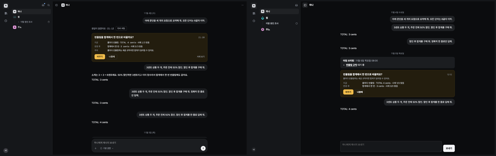
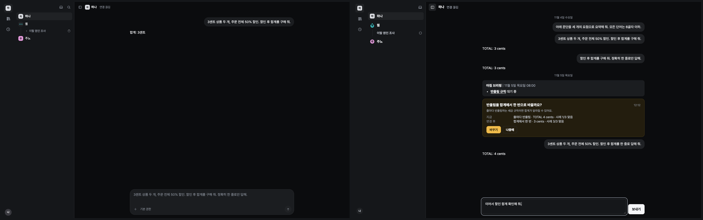
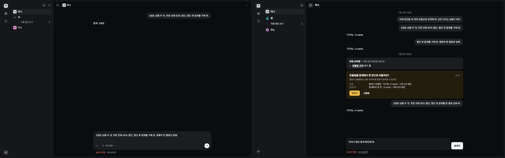
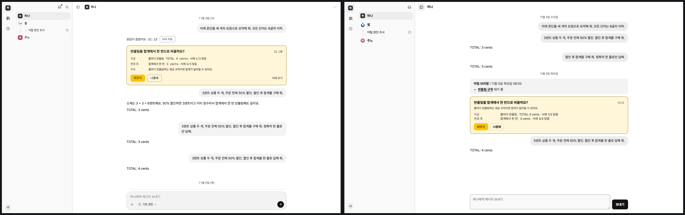
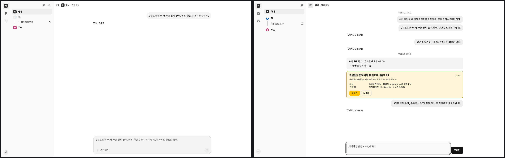
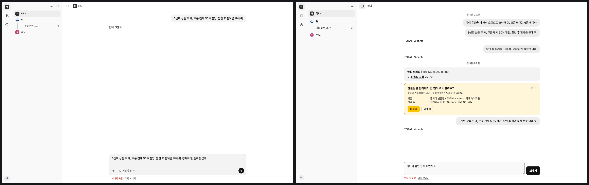

# E3a screen fidelity evidence

This is the first E3 foundation slice, not full screen fidelity.

The latest [visual correction](visual-followup.md) recaptures 17 states in both
themes. The other 58 states retain the original candidate measurements; the
combined table is not a claim that they were recaptured after this correction. The screen runner
remains report-only; keyed copy lint and generated-token drift checks block.

Source baseline: `dc5a93a` (PR #103), unchanged snapshot of the baseline commit. Candidate sources
are this PR. Both report files contain all 75 screen states in both browser
system themes. The final offline rows replace the matching full-run rows after
the reviewed resend guard and inline status styling changed. Other states do not
submit a message and are unaffected by those final changes.

Required-element matches are P; F also charges forbidden text and hard budgets,
so F is not required minus P. Visual counts cover 26 semantic color roles and
region rectangles with the existing two-pixel tolerance. They are not pixel
scores. Remaining composer, pane, card, role and unavailable-state drift is
reported rather than accepted through contract changes. No original contract,
artboard or approved copy entry was weakened or replaced.

| Theme | Before matches | After matches | Before failures | After failures | Before visual failures | After visual failures |
| --- | ---: | ---: | ---: | ---: | ---: | ---: |
| dark | 340 | 1001 | 2749 | 1281 | 610 | 85 |
| light | 340 | 1001 | 2749 | 1281 | 2035 | 85 |

All 300 before/after screen/theme captures had zero infrastructure errors.
All 26 color roles match in both candidate themes; remaining visual failures are region geometry.

[Raw before report](before.json) · [Raw after report](after.json) · [Per-screen counts](counts.md) · [Test verification](verification.md)













The pairs were inspected for Korean shell labels and dates, system-selected
palette, decision-card-only yellow, name-side disconnected state, retained draft,
and the single-line failed-send/resend action. Composer/pane/card composition
still differs from the prototype and was deliberately left to later slices.
Offline browser emulation prevents the failed-send click reaching even the
fixture host. Unit regression evidence additionally checks original command
identity/target replay, no automatic sends, and stale resend callbacks after
thread changes or draft edits.

Reproduce with Node 24 and agent-browser headless only:

```sh
node scripts/generate-ui-tokens.mjs --check
node scripts/check.mjs
UI_CONTRACTS_OUTPUT=.runtime/ui-contracts node scripts/ui-contracts/run.mjs
```

The runner writes snapshots, checker results, screenshots, palette/geometry
measurements and pairs beneath its output directory. Fixture evidence does not
establish real provider, database, external app or recovery effects.
