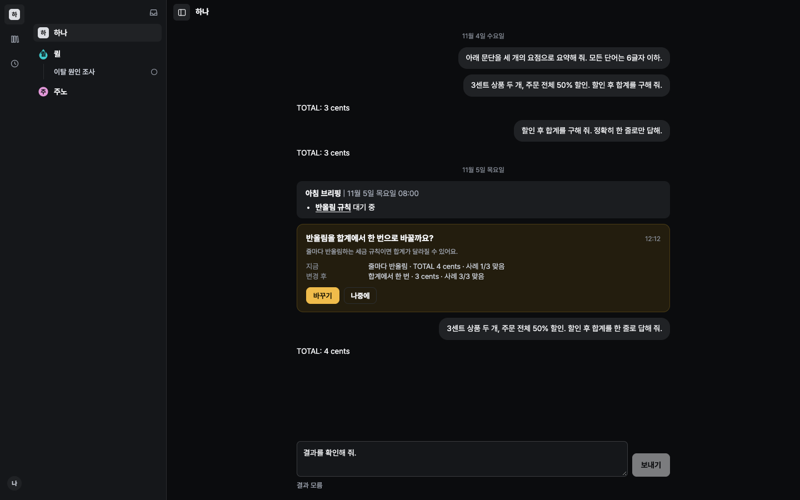
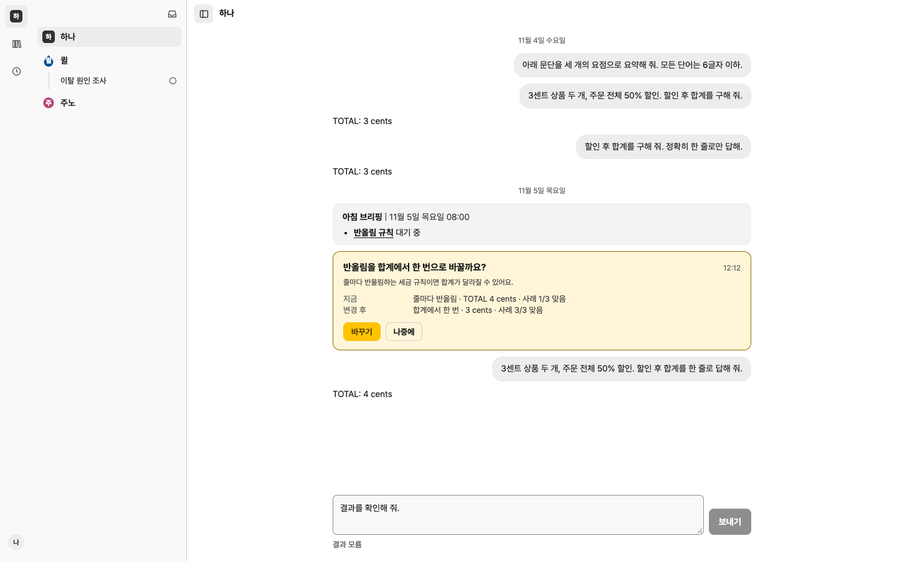

# Linux CI and unknown-delivery correction

## Root causes

1. The relation test treated the permanently hidden shell sync notice as a ready
   signal. Linux timing exposed review firing while the actual write gate was
   still locked, so its correct runtime guard ignored the click. The fixture now
   holds the replacement snapshot read, proves review/cancel/save cannot write
   while locked, then waits for enabled relation fields before explicit review.
   It retains the original stale-state regex, exact private values and revision,
   and checks both journals remain unchanged. Relation runtime code is unchanged.
2. The generator test hardcoded a macOS-only caller directory. It now creates
   and cleans up a real directory under `os.tmpdir()` and uses `fileURLToPath`.
   The original `null !== 0` launch failure was reproduced in Linux before the fix.
3. A lost response was incorrectly presented as not sent. The private draft now
   persists delivery uncertainty before dispatch. Unknown delivery has no resend
   action and normal Submit is also blocked, including after reload and for legacy
   saved command identities. Only proven pre-admission refusal, or an explicit
   offline check before dispatch, enables retry with the same ID and target.

## Regression coverage

The 17 delivery/draft regressions include lost responses, unclassified 500/503
responses, explicit unknown responses, reload, definite refusal, pre-dispatch
offline, stale actions, storage failure, a held query across two tabs, shared-lock
input ordering, original conversation keys, and pending-edit consumption without
losing newer private edits. All updates reuse the existing browser recovery lock;
network waits stay outside it. This is private UI metadata, not a new server API.

Full Node 24.21.0 check: **1,463 passed / 1 known baseline macOS locale failure /
340 environment-gated skips**. Static types, syntax, generator drift and keyed
copy lint pass. The known locale failure remains unchanged and was previously
reproduced on the unmodified baseline.

Actual Linux, local `node:24-bookworm` image, Node **24.22.2**, network disabled,
read-only repository mount, **TMPDIR=/tmp/massion-e3a-linux**: **29 passed / 0 failed /
5 existing database skips** across the relation, token and offline files. Both
named CI regressions run in that non-macOS temporary directory.

## Browser evidence

[Six final B2 runner rows](ci-rerun.json) have zero infrastructure errors and palette
mismatches. Existing layout/contract drift remains report-only. The failed-send
fixture now proves non-delivery before it can expose the existing retry treatment.

Separate headless checks in both themes submit to the read-only fixture host,
which rejects product commands with an unclassified HTTP 405 response. The client
conservatively shows unknown, disables Submit, retains the draft and original
identity/target across reload, and offers no resend button. This is not evidence
of a real committed effect or a provider call. Lost committed responses are
represented by unit fixtures. [Browser measurements](unknown-browser.json).

## Durable-host CI follow-up

The first fresh CI run passed the Linux type/syntax/unit stage, then exposed ten
additional UI expectations in the previously gated native host tests. Nine still
expected the removed sync banner to become visible after SIGKILL; one still
searched for the English acceptance label. These are corrected to observe the
actual connection badge, await enabled write fields at readiness/recovery, and
use the approved acceptance copy key. Runtime behavior, effect/receipt assertions,
private-draft preservation, original journals and no-replay checks are unchanged.

Reproduced **10 failures** before the changes in a network-disabled Linux Node 24
container with a disposable SurrealDB 3.3.0 extracted from the already installed
image. The same owned launcher and all three complete native test files then
passed **12/12, with zero skips**: `cli-host-kill.test.ts`,
`host-process-kill.test.ts`, and `host-cli.test.ts`. Eight kill boundaries retain
their original process ownership and no-replay verification. The database and all
child processes are owned by the temporary test launcher and cleaned up after it.
