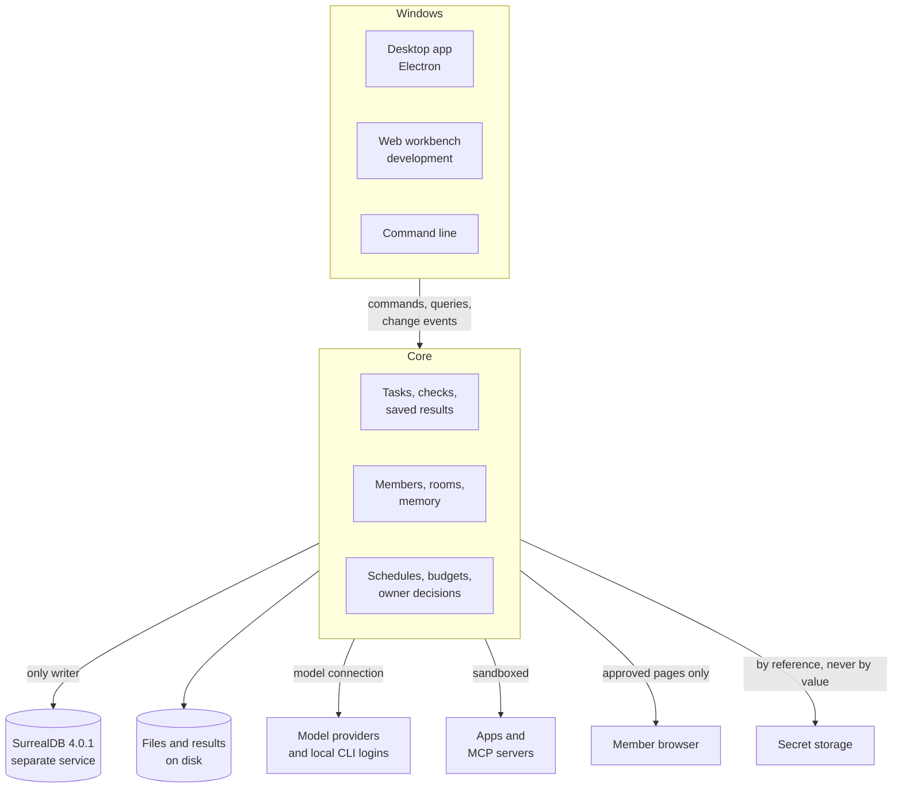
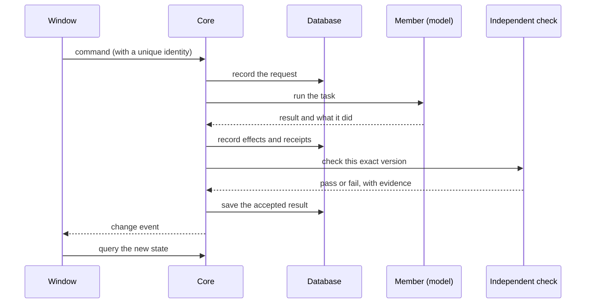

# Architecture overview

Massion is one long-running core that owns all work, with thin windows on top and replaceable connections underneath. This page shows the whole system once, then lists every design note by topic.

## The running system

Read this top to bottom: windows only show and ask, the core runs once per user and keeps going with no window open, it is the only thing that writes to the database, and everything outside goes through a boundary the core controls.

| Part | What it does | Read more |
| --- | --- | --- |
| Windows | Show state and send requests. Closing a window stops nothing. | [Desktop shell](desktop-shell.md), [ADR 0005](decisions/0005-desktop-app-protocol-and-adapter-boundaries.md) |
| Protocol | Three kinds of message: commands (change something, once), queries (read), change events (something changed, read again). The same for every window. | [Client protocol](client-protocol.md) |
| Core | Owns every task from request to saved result, including what happens after a crash or a lost reply. | [ADR 0001](decisions/0001-product-owned-core.md), [Product interface](product-interface.md) |
| Database | The single source of truth. The core records what it intends to do before doing it. | [Storage](storage.md) |
| Boundaries | Models, apps, browser, secrets and data location sit behind replaceable adapters. An unavailable adapter refuses; it never falls back to a weaker one. | [ADR 0005 §3](decisions/0005-desktop-app-protocol-and-adapter-boundaries.md#3-five-adapter-boundaries-for-a-later-cloud-version) |

> [!NOTE]
> Today the desktop app is an unsigned development shell that reaches the core over an authenticated connection on the local machine. The user-only socket, signed builds and the cloud implementations in ADR 0005 are designed, not built.

## What happens to one request

Read this as a timeline. The core writes down its intent before anything leaves the machine, so a crash or lost reply can be inspected instead of repeated.

If a reply is lost, the same command identity returns the original outcome. If an outside effect cannot be confirmed, it stays marked unknown until someone inspects it.

## Design notes by topic

Each note records one piece of the design and what was tested. Open a topic to see its notes.

<strong>Core, storage and recovery</strong> (16)

- [Configured bounded-text execution](configured-runtime.md)
- [Monthly budget end-to-end journey](e2e-monthly-budget.md)
- [Payment and external-member decisions (E6c)](effect-decisions.md)
- [Explicit owner closure of an expired original run](expired-run.md)
- [Bounded local Work admission capacity](host-admission.md)
- [Bounded local host drain](host-drain.md)
- [Monthly usage and owner budget decisions (E8)](monthly-budget.md)
- [Owner quarantine of interrupted configured Work](owner-quarantine.md)
- [Portable Work backup increment](portable-backup.md)
- [Local Mission/Work interface](product-interface.md)
- [Normal host reads exact relocated evidence](restored-artifact-reader.md)
- [Evaluated rounding-rule owner decisions (R-D)](rule-change-decisions.md)
- [Bounded host-owned run lifetime](runtime-lifetime.md)
- [Authoritative storage: bounded SurrealDB adapter](storage.md)
- [Typed payment decisions for text Works (R-S)](typed-payment-decisions.md)
- [Read stored unresolved Work across Missions](unresolved-work-inbox.md)

<strong>Conversation and Work</strong> (34)

- [Owner-reviewed accepted result to future Work source](accepted-result-source-draft.md)
- [Exact accepted text access](accepted-text-access.md)
- [Assistant conversation: the Representative answers and creates Work](assistant-conversation.md)
- [Surface skeleton 2: cards and lines inside the conversation](conversation-cards.md)
- [Conversation surface fidelity (E3b)](conversation-surface-fidelity.md)
- [Owner conversation → reviewed new Work](conversation-work-draft.md)
- [Inspect exact original source uses](document-usage.md)
- [Exact-version relationship neighborhood exploration](exact-knowledge-neighborhood.md)
- [File-read completion activity (R-Q)](file-read-activity.md)
- [Versioned owner Mission constraint revision](mission-constraint-revisions.md)
- [Mission discussion acceptance](mission-conversation-acceptance.md)
- [Mission discussion before first Work](mission-conversation-to-work.md)
- [Bounded non-text accepted results](non-text-results.md)
- [Explicit fresh Work after a known rejection](owner-correction-work.md)
- [Retained local document source and exact retrieval](owner-documents.md)
- [Owner-selected local UTF-8 file → document draft](owner-file-document-draft.md)
- [Exact owner-authored relationship records](owner-relations.md)
- [Owner clarification before first execution](owner-work-clarification.md)
- [Exact failed candidate inspection](rejected-candidate-text.md)
- [Generic bounded result facts (R-M redesign)](result-facts.md)
- [Results and schedules](results-and-schedules.md)
- [Exact owner Work sequence panel](run-sequence-panel.md)
- [Explicit bounded Work sequence](run-sequence.md)
- [Owner-created schedule kinds](schedule-kinds.md)
- [Schedule kinds, binary results and GitHub review context](schedules-results-github.md)
- [Confirmed steering during procedure execution](steering-continuation.md)
- [Steering revisions and safe restart continuation (R-O)](steering-resume.md)
- [Bounded typed tables](table-results.md)
- [Durable owner Work conversation](work-conversation.md)
- [Work pane fidelity (E3c)](work-pane-fidelity.md)
- [Exact owner prerequisite authoring](work-prerequisite-panel.md)
- [Causal Work prerequisites](work-prerequisites.md)
- [Explicit original source input for Work](work-sources.md)
- [Work step and check telemetry (R-A)](work-telemetry.md)

<strong>Members, teams and rooms</strong> (16)

- [Q15: Discriminator slot](discriminator-slot.md)
- [E9b: bounded real-model discriminator evaluation](e9b-discriminator-evaluation.md)
- [Internal teams per Work](internal-teams.md)
- [Member lifecycle](member-lifecycle.md)
- [Member memory candidates (R-D)](member-memory-candidates.md)
- [Member page producers (R-J)](member-page-producers.md)
- [Member-authored progress notes (R-W)](member-progress-notes.md)
- [Member rooms: bounded challenge before independent checking](member-rooms.md)
- [Member admission undo and authored replies](member-undo-attribution.md)
- [Member Work: handing Work to a member](member-work.md)
- [Members: admission, identity and 1:1 conversations](members.md)
- [Exact owner organization responsibility editing](organization-panel.md)
- [Bounded owner organization responsibility revisions](organization-revisions.md)
- [Room residuals and pane regressions](room-residuals.md)
- [Self-made skills and procedures](self-made-skills.md)
- [Team-room composition geometry](team-room-geometry.md)

<strong>Memory and Growth</strong> (10)

- [User proposals and host-owned bounded evaluation](growth-proposals.md)
- [Growth reflection trail and model-proposed memory candidates](growth-reflection-and-model-proposals.md)
- [Owner-declared explicit memory conflicts](memory-conflicts.md)
- [Explicit literal-content memory retrieval](memory-content-search.md)
- [Owner-declared explicit memory expiry](memory-expiry.md)
- [Explicit literal-ID memory version discovery](memory-find.md)
- [B12 memory rows and transition history](memory-history-b12.md)
- [Exact stored memory identities in usage reads](memory-usage-literal-ids.md)
- [Explicit exact-memory usage pages](memory-usage-pages.md)
- [Read-only exact memory version usage](memory-usage.md)

<strong>Models and connections</strong> (11)

- [Check predicate observation times (R-H)](check-observation-times.md)
- [Normal CLI host connection setup](cli-host-connections.md)
- [Connection lifecycle backend](connection-lifecycle-backend.md)
- [Default execution route and persistent connections](default-route-and-persistent-connections.md)
- [Family map, family check and model groups](family-map-and-model-groups.md)
- [Configured HTTP provider adapter](http-provider.md)
- [Provider connection setup and native model APIs](provider-connections.md)
- [One-shot provider dispatch claims](provider-dispatch.md)
- [Explicit execution connections and model selection](provider-selection.md)
- [First real-model smoke](real-model-smoke.md)
- [Typed credential rejection and bounded repair](token-expiry-repair.md)

<strong>Apps, browser and environments</strong> (11)

- [First app-frame resize delivery](app-frame-resize-race.md)
- [App secret presence](app-secret-presence.md)
- [Apps runtime v1](apps.md)
- [Browser environment actions (R-U2)](browser-actions.md)
- [Browser session and page snapshots (R-B)](browser-runtime.md)
- [Device lifecycle and General settings (R-L)](device-lifecycle.md)
- [Environment-neutral actions and owner waits (R-U1)](environment-actions.md)
- [Environment-backed member Work implementation plan (R-U2b)](environment-work.md)
- [MCP apps and connection cards (E5b)](mcp-apps.md)
- [Procedure-backed Work screens (R-G)](procedure-screens.md)
- [File delivery, active procedure notes and Record flow (R-N)](read-telemetry-procedure-edit.md)

<strong>Secrets and settings</strong> (8)

- [App lifecycle settings](app-lifecycle-settings.md)
- [App settings visual corrections](app-settings-visual.md)
- [Secret slots, bounded CLI launches and tool deadlines (E5a)](secret-launcher.md)
- [Owner-selected secret sources (R-T)](secret-sources.md)
- [Settings catalog availability (R-I)](settings-catalog-availability.md)
- [Settings fidelity (E3d1)](settings-fidelity.md)
- [Connection, app and member lifecycle (R-C)](settings-lifecycle.md)
- [Settings](settings.md)

<strong>Desktop app and client protocol</strong> (4)

- [Client protocol and feed push (E2)](client-protocol.md)
- [Electron development shell (E4)](desktop-shell.md)
- [First experience (E7)](first-experience.md)
- [Surface skeleton 1: rail, sidebar, activity and work pane](surface-skeleton.md)

<strong>Screen contracts and fidelity</strong> (12)

- [E2E app-frame network controls](e2e-app-frame-network.md)
- [E2E browser context race](e2e-context-race.md)
- [Decision, app and desktop journeys (E9a2)](e2e-decisions-apps-desktop.md)
- [End-to-end journeys (E9a, E9a2)](e2e-journeys.md)
- [Pages fidelity (E3d2)](pages-fidelity.md)
- [Work room step times and output order](pane-step-times.md)
- [Polish batch 2](polish-batch-2.md)
- [Contract baseline after E6c](rebaseline-after-e6c.md)
- [Remaining conversation states and polish (E3e)](remaining-states-fidelity.md)
- [E3a: Screen fidelity foundation](screen-fidelity-foundation.md)
- [Blocking screen and copy diagnostics (E3f)](ui-contract-blocking.md)
- [UI contract harness](ui-contract-harness.md)

<strong>Release</strong> (2)

- [Release candidate preparation (E9c)](release-candidate-preparation.md)
- [Release readiness (Q17)](release-readiness.md)

<strong>Other</strong> (1)

- [Find stored Missions from a fresh client](stored-mission-catalog.md)

