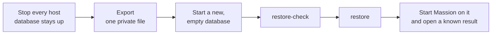

# Back up and restore

A portable backup is one private file you can move to another machine. Restoring it brings back your history without running anything again.

| A portable backup includes | It does not include |
| --- | --- |
| Supported work history | Host settings |
| Sealed text results | Credentials and connection configuration |
| Old accepted results and unknown outcomes, kept as they were | Arbitrary workspace files |

Keep the right-hand items separately if you need the whole installation.



## Make a backup

1. Stop and drain every host using the database. Leave the database running.
2. From the same checkout, for the persistent web setup:

   ```sh
   mkdir -p .runtime/backups
   node scripts/backup.ts export http://127.0.0.1:18080/rpc massion massion \
     "$(pwd -P)/.runtime/workspaces/model-artifacts" \
     "$(pwd -P)/.runtime/backups/work.json"
   ```

3. Copy the private bundle to a location covered by your backup policy.

> [!NOTE]
> Choose a new filename each time. The command refuses to overwrite an existing bundle. Do not upload a bundle with a bug report.

### When you need everything

For a complete installation copy, stop the database too and keep its whole data directory, the workspaces and your explicit configuration.

> [!WARNING]
> Copying a running database's files is not a consistent backup. An unsupported non-text result makes the portable export refuse; in that case preserve the complete offline installation instead.

## Restore into a new destination

Keep the original installation and backup until you have checked the restored one.

1. Start a second database using the [install command](install.md), with new data and temporary directories, port `18081`, and namespace and database both named `restored`. Keep its Massion host stopped.
2. From the original checkout, check, restore, then start:

   ```sh
   node scripts/backup.ts restore-check http://127.0.0.1:18081/rpc restored restored \
     "$(pwd -P)/.runtime/restored-text" "$(pwd -P)/.runtime/backups/work.json"
   node scripts/backup.ts restore http://127.0.0.1:18081/rpc restored restored \
     "$(pwd -P)/.runtime/restored-text" "$(pwd -P)/.runtime/backups/work.json"
   MASSION_SURREAL_RPC=http://127.0.0.1:18081/rpc \
   MASSION_SURREAL_NAMESPACE=restored MASSION_SURREAL_DATABASE=restored \
     npm start -- --restored-bundle "$(pwd -P)/.runtime/backups/work.json" \
     --restored-artifact-root "$(pwd -P)/.runtime/restored-text"
   ```

3. Open a previously accepted result and inspect its text before relying on the restored installation.

| Requirement | Why |
| --- | --- |
| The destination database is empty and the restored-text folder does not exist | Restore never writes over existing data |
| Keep the original bundle beside the restored text | Both startup options are needed to read relocated results |
| `restore-check` passed | It checks the backup against the client's size budget. It does not prove the database server can accept it |

Restore grants no new permission and does not resend unresolved work.

> [!WARNING]
> If restore reports an **unknown** outcome, keep the bundle, the destination database, the staged text and the reported restore identity. Do not repeat the restore into that destination. Use the [recovery reference](../architecture/portable-backup.md) for read-only inspection and the supported recovery boundaries.
