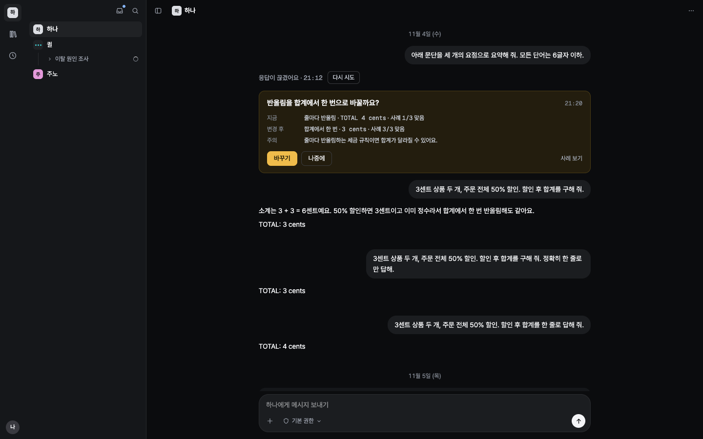
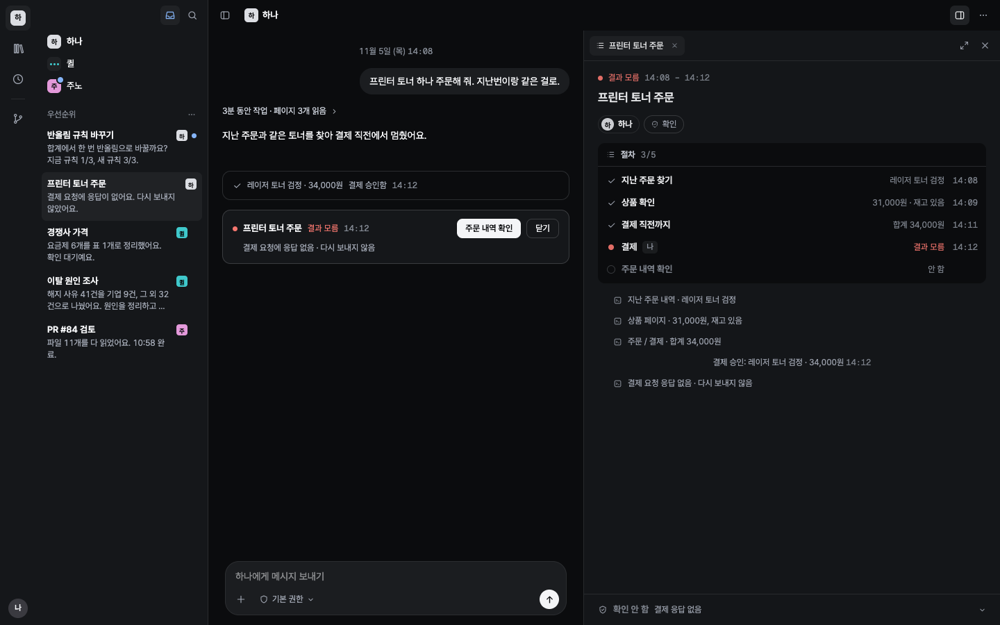
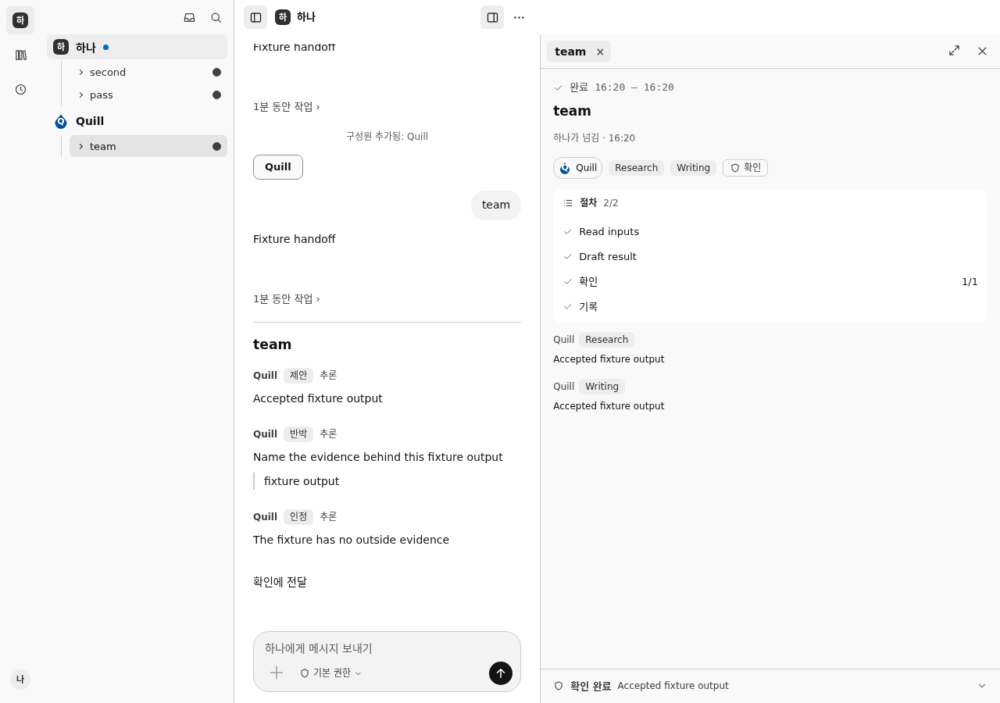

# Everyday use

You keep one conversation going. Small things are answered there; bigger jobs become tasks you can open beside it.

<picture>
  <source media="(prefers-color-scheme: light)" srcset="../product/screens/artboards/light/B2.png">
  
</picture>

Approved screen design; the interface is in Korean.

## Where things are

| Place | What it shows |
| --- | --- |
| **Conversation** | Your continuing thread with your assistant (the Representative). Direct replies appear here. Delegated work appears as a progress line or card; open it to follow the work beside the conversation. |
| **Sidebar** | Admitted members and their work. |
| **Activity view** | Running work and items that need your attention. |
| **Room** | For work given to a member: its steps, results and any supported challenge exchange between members. |
| **Member conversation** | Each member has one continuing private conversation with you. |

> [!NOTE]
> A challenge or a concession between members is discussion, not acceptance. The separate check still decides whether the result is accepted.

## Change direction or stop

| You want to | What happens |
| --- | --- |
| Redirect running work | Write a note about it. The note can propose a change of direction; confirm the change before expecting it to apply. |
| Give a member more permission | General discussion does not grant permissions. Use the explicit decision or setting. |
| Stop work | The work stops. Anything already sent outside Massion is not undone. |

## Check a result

Open the result's details to see its criteria, evidence and saved Record.

| Result | What it means |
| --- | --- |
| **Accepted** | It passed an independent check bound to that exact version. A separate check ran; this does not guarantee every model judgment is correct. |
| **Direct answer in the conversation** | No check ran and nothing was saved as an accepted Record. |
| **Rejected** | The original is kept. You can start a correction task from it (below). |
| **Unknown** | Massion cannot establish what happened. See the next section. |

### Correct a rejected result

1. Open the expanded details and choose the rejected original.
2. Enter the corrected request and your reason.
3. Review and admit the new work.
4. Start it explicitly. Admission alone does not run it.

The rejected original stays intact, and the correction gets its own check.

## When a result is unknown

<picture>
  <source media="(prefers-color-scheme: light)" srcset="../product/screens/artboards/light/B7-unknown.png">
  
</picture>

Approved screen design; the interface is in Korean.

> [!WARNING]
> Unknown means the host cannot tell whether the action happened. Waiting, reloading or restarting does not make it safe to send again. Keep the original entry, inspect the available evidence, and do not describe an unchecked result as accepted. Read [troubleshooting](troubleshooting.md) before trying recovery.

Development screenshot from the end-to-end run with local model fixtures. The room shows completed steps and a separate completed check; the challenge text is kept in the conversation. It is not a real analysis result.

Next: [decisions you make](owner-decisions.md).
