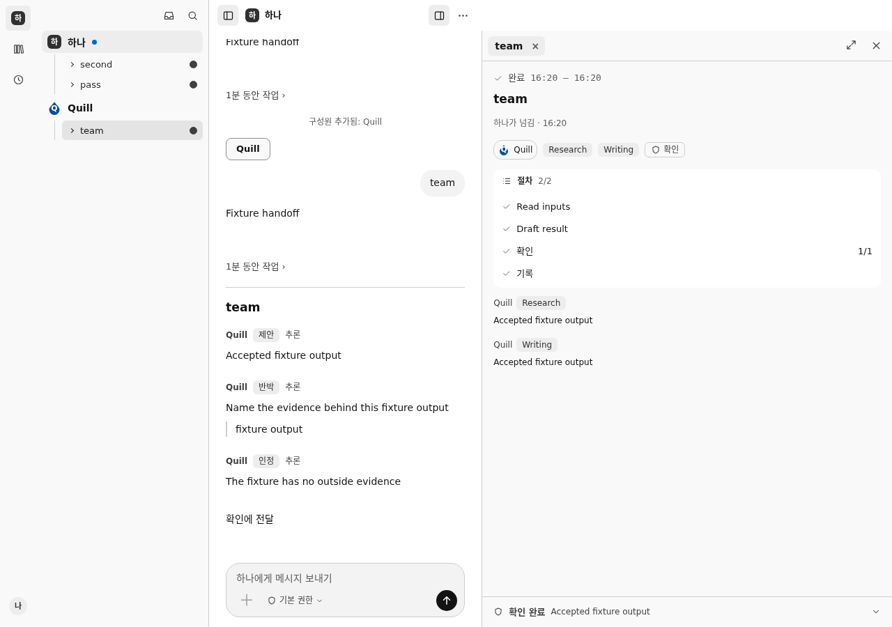

# Everyday use

Continue the same conversation with the Representative. A direct reply answers
in the thread. Delegated work gains a progress line or card; open it to follow
the work beside the conversation. The sidebar lists admitted members and their
work. The activity view helps find running work and items needing attention.

For work given to a member, the room shows its steps, results and any supported
challenge exchange. A challenge or concession is discussion, not acceptance.
The separate check still decides whether the result is accepted.

Each member has one continuing private conversation. A note about running work
can propose a change of direction; confirm the change before expecting it to
apply. General discussion does not grant permissions. Stopping work does not undo
an effect already sent outside Massion.

## Check a result

Open the result's details to inspect its criteria, evidence and retained Record.
An accepted result has passed an independent check bound to that version. This
means a separate check ran; it does not guarantee that every model judgment is
correct. A direct conversational answer has no accepted Record.

A known rejected result can be the source of a new correction task. In the
expanded details, choose the rejected original, enter the corrected request and
reason, review them and admit the new work. Admission alone does not run it;
start it explicitly. The rejected original stays intact and the correction gets
its own check.

## When a result is unknown

An unknown result means the host cannot establish what happened. Waiting,
reloading or restarting does not make it safe to resend. Keep the original entry
and inspect available evidence. Do not describe an unchecked result as accepted.
See [troubleshooting](troubleshooting.md) before trying recovery.

This development screenshot comes from the end-to-end run with local model
fixtures. The room shows completed steps and a separate completed check; the
challenge text is retained in the conversation. It is not a real analysis result.
