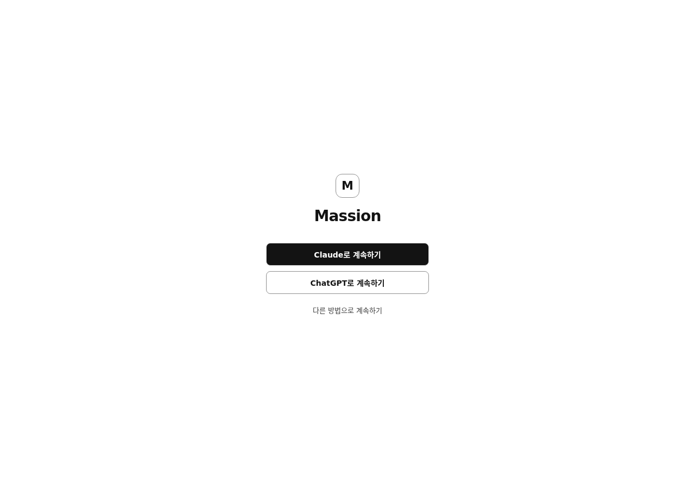

# Your first conversation

With no detected subscription and no configured connection, the first screen
shows login choices. An explicit click starts the provider's own login flow.
Massion does not ask you to paste credentials into the conversation.

A detected local login opens the greeting and suggestions. Detection only means
the provider reports a local login: it does not authorize execution, select a
model or prove that the account works. Existing configured connections also let
you reach the conversation.

The development build still needs explicit host connection configuration and
permission before model-backed work can run. Use the separate
[connection setup reference](../architecture/cli-host-connections.md); installation
alone does not enable paid calls. Without a usable connection, work remains
blocked instead of silently switching to a demonstration model.

Type a request into the continuing conversation. A short question can end with a
direct reply. Ask for a checked result, a file or a task with several steps to
have it delegated. A direct reply is conversation, not a checked result.

The first suggestions can open a task picker. Merely selecting a suggestion does
not send the request; **Assign** sends it. Deferring the mail suggestion connects
no account. Its connection link opens Apps settings; it is not proof that Gmail
is connected or that mail can be read.

Start with a small, non-sensitive request whose result you can recognize. Follow
its progress and open the result's details to inspect what happened.

Captured from the end-to-end run with simulated login detection. No real account
was opened or authenticated.
