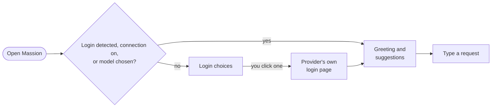
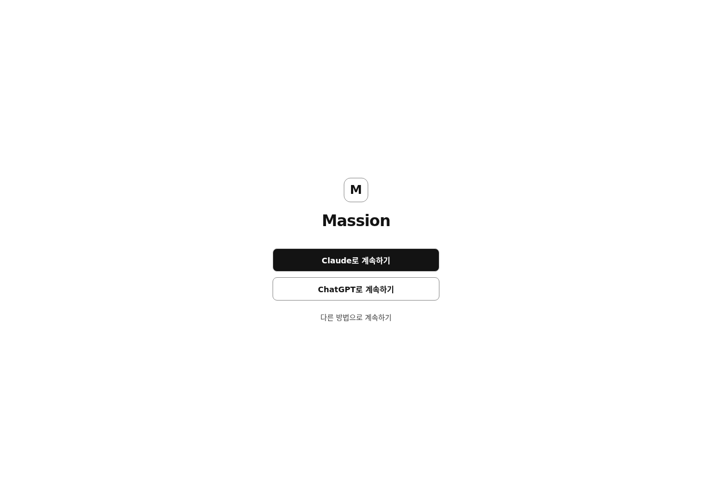

# Your first conversation

What you see on first launch depends on whether Massion finds a login, a connection that is on, or a model you already chose.

| You see | What it means |
| --- | --- |
| **Login choices** | No subscription login was detected, no connection is on and no model has been chosen. Clicking one asks Massion to start that provider's own login flow. If the provider's program is not set up or cannot be verified, the login does not start and the screen says it is unavailable. When the login status read says that provider is already logged in, the login command is not started and the connection is turned on directly; when the state could not be read, a login is attempted. A login completed outside Massion between that read and the start cannot be seen. Massion never asks you to paste credentials into the conversation. |
| **A greeting with suggestions** | A subscription login was detected, a connection is on, or a model has been chosen. You also see it after following the other-connection link on the login choices. Whether your first message is answered depends on the conditions below. |

> [!IMPORTANT]
> A detected login is used only through the host's explicit activation paths. Detection alone calls no model. The model that answers you is chosen in one of these ways, and the record says for each whether you chose it or Massion picked it for you:
>
> - you choose it in Settings > Connections; on a subscription connection whose login is detected, that choice also turns the connection on;
> - you start a login from this screen while no connection is on;
> - when an owner opens the conversation while no connection is on, no Representative route is set or closed, and at least one subscription login is detected, the conversation screen reads `firstCandidate` from `GET /connections` and sends one `POST /connections/<id>/profiles` request for the first login in a fixed order — Claude Code, then Codex (`FIRST_MESSAGE_LOGIN_ORDER`).
>
> With more than one login detected, the first login in that fixed order is chosen instead of waiting for a choice (decided 2026-11-17): of five apps compared that day, four pick one without asking when several providers are usable; this repository's earlier wait came from the design text of the connections change itself (PR #177), not from an owner request or an architecture decision, and the choice screen that text deferred to was never built; and a subscription has no per-call charge, so turning a subscription connection on is a lighter authorization than turning on an API-key connection.
>
> Sends are locked while the initial connection list request or this turn-on request is in flight (each bounded at 15 s) and unlock once a route is installed, the request fails, or the bound expires; any text already typed stays in the composer. Sending a message itself does not turn any connection on: if no Representative route is set when you send (for instance because turn-on failed or no login was ready), the turn is stored as `not_started` with reason `assistant_route_missing`.
>
> Nothing is chosen for you when you added a key in Settings > Connections (that turns the connection on but chooses no model), when you removed the chosen model, or when the requester lacks owner proof (an unauthenticated host running without sign-in and without live execution). The conversation then waits until a model is chosen again: choosing a model in Settings > Connections sets the route only while none was chosen and none was closed — it turns the chosen connection on when its login is detected, never replaces a route that is already chosen, and never reopens one you removed. A model that is chosen stays chosen, whatever logins are detected later.
>
> A login that is found does not prove the account works. A reply proves it does; a missing reply can also have other causes. Started with a host configuration file (the developer path), connections come from that file and live model calls still need the explicit flag: see [connection setup](../architecture/cli-host-connections.md). Without a usable connection, work stays blocked. It never silently switches to a demonstration model, and installation alone does not enable paid calls.

When both subscription CLIs are already logged in, this login screen is not drawn at all: opening the conversation screen turns on the first login in the fixed order above for an owner requester. Choosing a model in Settings > Connections turns that connection on, but a route that is already chosen stays chosen; no screen replaces it today. A host started from a source checkout with `npm start` has no owner sign-in: `GET /connections` returns `firstCandidate: null` because the requester is unattributed (and `POST /connections/<id>/profiles` would refuse with `not-owner`), whereas the login-start route has no owner check on such a host and, when a login starts or the login is already present, does turn the connection on — [issue #182](https://github.com/jabdori/massion/issues/182).

## Ask for something

Type into the conversation. What happens next depends on the size of the request.

| You ask for | Massion does | Is the result checked? |
| --- | --- | --- |
| A short question | Replies directly in the conversation | No. A direct reply is conversation, not a checked result |
| A checked result, a file, or a job with several steps | Hands it off as a task | Yes, by an independent check |

Both rows need a chosen model: without one Massion does not reply and no task starts.

Start with a small, non-sensitive request whose result you can recognize. Follow its progress, then open the result's details to see what happened.

## The first suggestions

- A suggestion can open a task picker. Selecting it sends nothing; **Assign** sends it.
- Deferring the mail suggestion connects no account.
- Its connection link opens Apps settings. That is not proof that Gmail is connected or that mail can be read.

Captured from the end-to-end run with simulated login detection. No real account was opened or authenticated.

Next: [everyday use](everyday-use.md).
