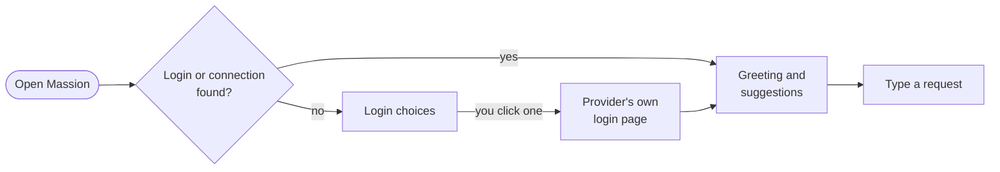

# Your first conversation

What you see on first launch depends on whether Massion finds a login it can use.

| You see | What it means |
| --- | --- |
| **Login choices** | No subscription login and no configured connection was found. Clicking one starts that provider's own login flow. Massion never asks you to paste credentials into the conversation. |
| **A greeting with suggestions** | A local login was detected, or a connection is already turned on. Sending a message starts using the detected login. |

> [!IMPORTANT]
> A detected login is used only once you act. Massion turns a connection on when you start a login from this screen, add a key in Settings > Connections, or send your first message while exactly one subscription login is detected; that moment is recorded as your decision. Detection alone calls no model, and with two logins detected nothing is chosen for you. A login that is found does not prove the account works: the first reply shows whether it does. Started with a host configuration file (the developer path), connections come from that file and live model calls still need the explicit flag: see [connection setup](../architecture/cli-host-connections.md). Without a usable connection, work stays blocked. It never silently switches to a demonstration model, and installation alone does not enable paid calls.

## Ask for something

Type into the conversation. What happens next depends on the size of the request.

| You ask for | Massion does | Is the result checked? |
| --- | --- | --- |
| A short question | Replies directly in the conversation | No. A direct reply is conversation, not a checked result |
| A checked result, a file, or a job with several steps | Hands it off as a task | Yes, by an independent check |

Start with a small, non-sensitive request whose result you can recognize. Follow its progress, then open the result's details to see what happened.

## The first suggestions

- A suggestion can open a task picker. Selecting it sends nothing; **Assign** sends it.
- Deferring the mail suggestion connects no account.
- Its connection link opens Apps settings. That is not proof that Gmail is connected or that mail can be read.

Captured from the end-to-end run with simulated login detection. No real account was opened or authenticated.

Next: [everyday use](everyday-use.md).
