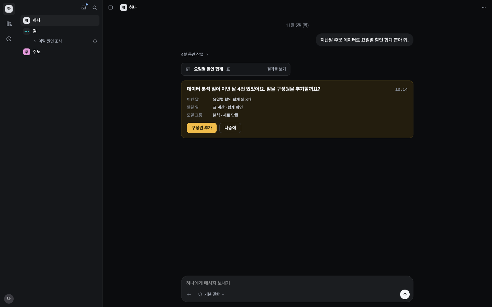
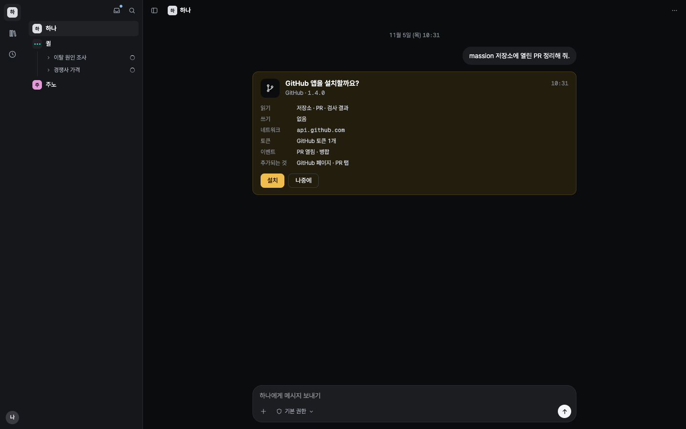

# Decisions you make

Massion works without asking, except for two kinds of decision that are always yours.

| Kind | Examples |
| --- | --- |
| **Actions with lasting effects** | Spending money, sending in your name, deleting, admitting another member |
| **Changes to checking rules or permissions** | Network scope, budget scope, what a member or app may access |

There is no general "autonomy level" that bypasses checking or permissions.

> [!NOTE]
> These rules describe the intended product boundary. The current build does not yet have a usable path for every kind of decision. The table below says what works today.

## Available now

<picture>
  <source media="(prefers-color-scheme: light)" srcset="../product/screens/artboards/light/B21.png">
  
</picture>

Approved screen design; the interface is in Korean.

| Decision | What you can do | Good to know |
| --- | --- | --- |
| **Admit a member** | Defer the proposal, or admit the member with a name and appearance | A member's internal workers do not become permanent members |
| **Install an app** | Review what it asks to access on the decision card, then install or defer | Deferring installs nothing. An update that widens permissions asks again; disabling an app narrows access |
| **Payments and external members** | Answer through their explicit decision paths | A sent request or an arrival receipt is not an accepted result |
| **Connections and grants** | Manage model connections, explicit execution grants and per-task budgets in settings and expanded details | |
| **Monthly budget** | See monthly and per-member token usage and set a monthly output-token limit | Work that cannot reserve its budget waits for your decision. Accepting an increase releases unchanged waiting work through normal admission; a new month alone does not resume it |

<picture>
  <source media="(prefers-color-scheme: light)" srcset="../product/screens/artboards/light/B24.png">
  
</picture>

Approved screen design; the interface is in Korean.

## Limits to keep in mind

- **Installing is not connecting.** Installing an app does not connect an external account or prove that a token is valid.
- **Linux with Node 24 cannot run app code**, because the required sandbox is unavailable there. Installation is not evidence that the app ran.
- **A timed-out write to an MCP server stays unknown** until you record reconciliation evidence. Only then can a later, distinct write proceed.
- **No real purchases were tested.** Payment and external-member journeys in the automated tests use local fixtures, not real purchases or remote delivery.
- **No bundled payment service.** There is no production payment service and no claim of compatibility with live third-party accounts. A prototype picture, an installed app or a fixture receipt does not establish that an account is connected, a purchase happened or a remote task was accepted. Review the configured adapter and its evidence before relying on an external effect.

Next: [your records and files](records.md).
