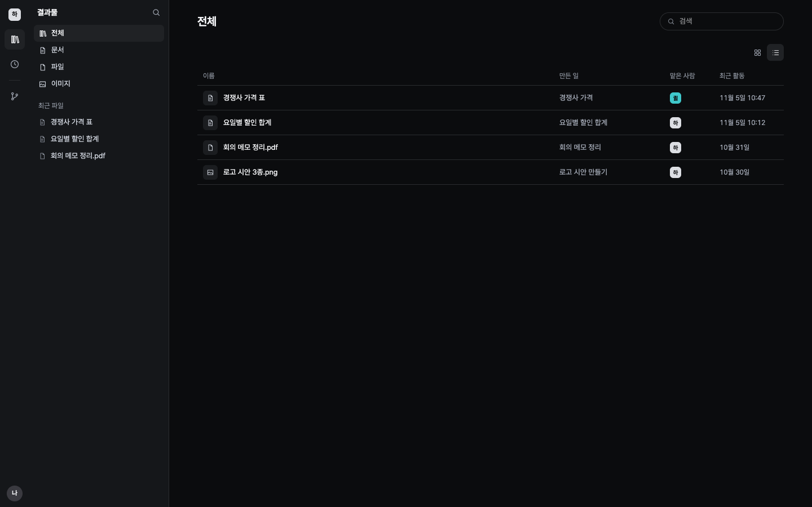

# Your records and files

Massion keeps two different things, and they are not interchangeable.

| Kept | Contains | Changes later? |
| --- | --- | --- |
| **Conversation** | What you said and the replies you received | It continues |
| **Accepted Record** | A checked result and the exact evidence used to accept it | Never rewritten. A later correction creates a new history entry |

The results shelf collects available results. Open a result and its details to see the request, the steps and the check.

<picture>
  <source media="(prefers-color-scheme: light)" srcset="../product/screens/artboards/light/B10.png">
  
</picture>

Approved screen design; the interface is in Korean.

> [!IMPORTANT]
> Keep the stored evidence when you move an installation. The conversation alone cannot replace the accepted files.

## Where it lives

For the persistent web setup in this guide (paths are relative to the folder where you started the web host):

| What you keep | Where it lives |
| --- | --- |
| Conversation, work history, members and settings | `.runtime/database`, using the database named `massion` |
| Workspaces and sealed result text | `.runtime/workspaces/` |
| Your chosen connection configuration | The host configuration file you supplied |
| A portable backup | The private file you choose at export |

The desktop app uses its own private app-data directory for its host and workspaces; see [desktop setup](../../desktop/README.md#run). The database remains the separate service you configured.

## Keep it private and safe

- **Credentials stay where you configured them.** They are not included in a portable backup.
- **Backups are still private.** They may contain conversations and result text.
- **The disposable test/demo launcher deletes its database at exit.** Use the [persistent installation](install.md) for everyday data.
- **Before moving or upgrading**, follow [backup and restore](backup-restore.md).
