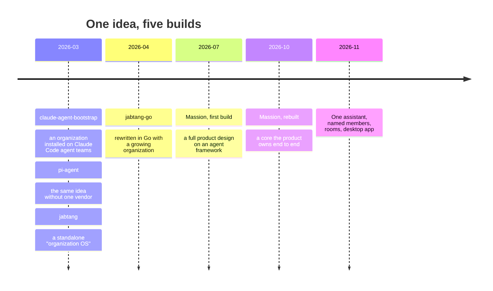

# How Massion got here

Massion follows one idea through five builds: **run AI as an organization that you own, and let it get better at its work.** The tools changed each time. The idea did not. Most of today's rules exist because an earlier build failed in a specific way. This page shows each turn, what was learned, and which rule came from it.

The first step is [claude-agent-bootstrap](https://github.com/jabdori/claude-agent-bootstrap). The first Massion build is preserved in [massion-archive](https://github.com/jabdori/massion-archive).

## The turns

Each row is one judgment: what was built, why, and why it was not enough.

| When | Built | Why it was built | Why it was not enough |
| --- | --- | --- | --- |
| Mar 2026 | **claude-agent-bootstrap** | Claude Code had just gained agent teams. The idea: do not hand everything to one AI; run it like a company. One representative you talk to, departments, specialists, a memory. | The organization was installed into a host tool and lived by that tool's rules. The core could not be owned. |
| Mar 2026 | **pi-agent** | Stop depending on one vendor's tool. | It was a base, not yet an organization. |
| Mar 2026 | **jabtang** | Build the organization on that base: a fixed flow from representative through strategy, approval and delivery to records. First time organization, changing departments and self-improvement were one program. | The base could not carry the system it was meant to become, and the organization was fixed too early. |
| Apr 2026 | **jabtang-go** | Rewrite in Go for precise control of execution. The organization can grow at runtime. Lasting structure is separated from one-off execution. | Extending it meant rebuilding, model support was thin, and a database feature it needed was missing in Go. |
| Jul 2026 | **Massion, first build** | Keep the organization and its rules; replace only the engine underneath. The engine decides how one turn runs. The product decides what is approved, adopted and created. | See below. This is the turn that shaped today's product most. |
| Oct 2026 | **Massion, rebuilt** | Own the whole path from request to accepted result. No framework decides what counts as done. | Current work. |

## What the first build got wrong, and the rule each failure became

The first Massion build looked complete on paper. [ADR 0001](../architecture/decisions/0001-product-owned-core.md) records five ways it failed in practice. Each one is now a rule the product enforces.

| What went wrong | The rule today |
| --- | --- |
| The framework delegated work in ways the product could not see | Massion owns delegation: who was assigned what, with which inputs, model and budget |
| A model finishing its answer was treated as the task being done | A result is accepted only after an independent check against written criteria |
| An action with an uncertain outcome was run again | An unknown outcome stays unknown. It is inspected, never resent |
| Old evidence was used to accept a newer result | Evidence is bound to one exact version. A changed result needs a new check |
| Features were documented but had no working path | Every page says what is built today and what is only planned |

This is why the documentation is full of caveats, and why Massion would rather stop and ask than retry.

## The same judgment, applied to the screen

Once the rebuilt core worked, the first live run showed a different problem: one task took more than ten steps. The next four decisions, all in November 2026, are about making a strict core easy to live with.

| Date | Decision | The judgment behind it |
| --- | --- | --- |
| 5 Nov | [One assistant; independent checks](../architecture/decisions/0002-assistant-first-surface-and-independent-checks.md) | People want one conversation, not a control panel. And if the owner must approve everything, the owner becomes the bottleneck. The rule is not "a person approves" but "nothing is accepted on its author's own judgment". |
| 5 Nov | [Named members, no titles](../architecture/decisions/0003-members-internal-teams-model-groups-and-apps.md) | The earlier department tree added hand-offs without adding assurance for a single owner. What people actually manage is a named member, so that is what the screen shows. |
| 7 Nov | [Rooms and mutual challenge](../architecture/decisions/0004-member-rooms-mutual-challenge-and-discriminator.md) | Members never talked to each other; work moved down a fixed line. Letting them question each other catches problems before the final check. |
| 9 Nov | [Desktop app, one protocol](../architecture/decisions/0005-desktop-app-protocol-and-adapter-boundaries.md) | Schedules stopped when the terminal closed. The core has to keep running whether or not a window is open. |

## What never changed

Through every build, the same commitments:

- **AI works as an organization**, not as one model doing everything.
- **The engine is a replaceable part.** It decides how one turn runs. The product decides who does, checks and approves the work.
- **Whoever did the work does not approve it.**
- **The owner stays in control** of what cannot be undone and of the rules themselves.
- **The organization grows**, and changes to how it works are tested before they are kept.
- **Your data stays with you**, in one place that is the source of truth.
